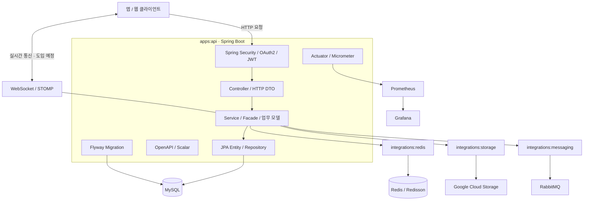

To-do, 집중 세션과 회고, 기간별 집중 통계를 제공하는 TOMO의 백엔드 저장소로, 기능별 업무 코드는 `apps:api`에서 관리하고 외부 시스템 연동은 `integrations` 모듈로 분리합니다.

## ⚙️ 기술 스택 (Tech Stack)

<div align="center">

### Backend & Infrastructure

<p>


</p>

### Database & Persistence

<p>


</p>

### Auth & API Documentation

<p>


</p>

### Real-time & Storage

<p>


</p>

### Monitoring & Quality

<p>


</p>

</div>

GCP Compute Engine·Cloud SQL for MySQL·Cloud Storage를 배포 환경으로 사용하며, Docker 배포와 Prometheus·Grafana 모니터링, GitHub Actions 빌드·배포 자동화는 후속 작업으로 진행합니다.

외부 연동 모듈에는 의존성이 준비되어 있으며 실제 기능은 순차적으로 구현합니다.

## 🏗️ 백엔드 아키텍처 (Backend System Architecture)

HTTP 요청은 Controller에서 받아 Service·Facade에서 처리하며, JPA 저장 구현은 실행 앱에 두고 Redis·메시징·파일 저장은 연동 모듈을 통해 연결하는 구조를 목표로 합니다.



## 🔐 인증 구조 (Authentication)

현재는 Scalar·OpenAPI 문서의 GET 요청을 허용하고 다른 경로의 미인증 요청에는 `401`을 반환하는 기본 보안 설정을 적용했으며, 이후 아래 흐름에 따라 Google·Kakao OAuth2 로그인과 JWT 발급·검증을 구현할 예정입니다.

```text
1. 사용자가 Google 또는 Kakao 로그인을 요청한다.
2. 서버가 소셜 인증 결과와 연결된 사용자 정보를 확인한다.
3. 인증 결과에 따라 JWT를 발급한다.
4. 클라이언트가 보호된 API 요청의 Authorization 헤더에 Bearer 토큰을 전달한다.
5. 서버가 토큰과 접근 권한을 검증한 뒤 요청을 처리한다.
```

기능별 Controller는 `controller/docs`의 `*ApiDocs` 인터페이스를 구현해 문서 설명을 분리하며, 인증이 필요한 API에는 `OpenApiConfig`에 등록된 `bearerAuth`를 참조하도록 `@SecurityRequirement(name = OpenApiConfig.BEARER_AUTH)`를 선언합니다.

## 🗄️ 데이터 처리 방식 (Database & Persistence)

| 구분 | 기술 | 역할 |
| --- | --- | --- |
| Main Database | MySQL | 사용자, To-do, 집중 세션·회고, 동의 이력과 알림 저장 |
| ORM | Spring Data JPA / Hibernate | 엔티티 매핑과 데이터 조회·저장 |
| Migration | Flyway | 테이블·인덱스·제약조건의 버전별 변경 관리 |
| Cache / Lock | Redis / Redisson | 캐시·임시 상태와 필요한 작업의 분산 락 |
| File Storage | Google Cloud Storage | 프로필 이미지 등 업로드 파일 저장 |

초기 스키마는 `apps/api/src/main/resources/db/migration/V1__init_schema.sql`에서 정의하며, `ddl-auto: none`으로 Hibernate의 자동 스키마 생성을 끄고 Flyway로 변경 이력을 관리합니다.

스키마를 변경할 때는 이미 적용된 마이그레이션을 수정하지 않고 후속 버전 파일을 추가하며, 사용자 UUID는 Spring에서 생성해 저장합니다.

## 🚀 배포 및 모니터링 (Deployment & Monitoring)

GCP를 기준으로 아래 구성을 준비하고 있으며, 현재 디렉터리 구조만 마련된 `infra`에 배포 파이프라인과 모니터링 서버 설정을 추가할 예정입니다.

GitHub Actions의 CI 파일은 수동 실행용 자리표시자로, 실제 빌드·테스트는 아직 연결하지 않은 상태입니다.

| 구성 요소 | 목표 기술 | 역할 |
| --- | --- | --- |
| 애플리케이션 서버 | Compute Engine / Docker | Spring Boot 애플리케이션 실행 |
| 관계형 DB | Cloud SQL for MySQL | 영구 데이터 저장 |
| 파일 저장소 | Cloud Storage | 업로드 파일 저장 |
| 지표 수집 | Actuator / Micrometer / Prometheus | 애플리케이션 상태·지표 수집 |
| 대시보드 | Grafana | 지표 시각화 |
| 로그 | Logback / Loki | 로그 기록·수집·조회 |
| CI/CD | GitHub Actions | 빌드·검증·배포 자동화 |

## 🛠️ 개발 환경

- Java 21 (JDK)
- Spring Boot 3.5.16, Spring MVC
- Gradle 8.14.3 (Wrapper 포함)
- 기본 패키지: `com.tomo`

`JAVA_HOME`을 JDK 21 경로로 설정하고, IntelliJ에서는 루트 `settings.gradle`을 열어 Gradle JVM을 Java 21로 지정합니다.

## 📂 프로젝트 구조

```text
backend/
├── apps/api/         # 실행 클래스, 기본 설정, 서버 시작 테스트
├── integrations/     # storage·redis·messaging 연동 라이브러리
├── infra/            # docker·monitoring·gcp 배포 설정
├── gradle/wrapper/   # Gradle Wrapper
└── docs/             # 코드·명세·협업 규칙
```

`apps:api`에서 사용하는 Java 라이브러리 모듈인 `integrations:storage`, `integrations:redis`, `integrations:messaging`에는 각각 GCS SDK, Spring Data Redis·Redisson, Spring AMQP 의존성이 준비되어 있으며 실제 클라이언트 구성과 연동 구현은 후속 작업으로 진행합니다.

`infra`는 배포 설정을 관리하는 디렉터리로 Gradle 모듈에 포함하지 않으며, 배치 앱은 필요해지는 시점에 추가합니다.

Spring 라이브러리와 JUnit·Mockito·AssertJ·Testcontainers의 버전은 루트 `build.gradle`에서 Spring Boot BOM을 공통 적용해 관리하되, 각 모듈에 같은 BOM 선언을 반복하거나 품질 검사 도구의 의존성에 적용하지 않습니다.

개별 버전을 지정하는 라이브러리는 JJWT 0.13.0, springdoc Scalar 2.9.1, Redisson 3.52.0, Google Cloud Storage 2.75.0입니다.

## ▶️ 서버 실행과 패키징

### Windows (PowerShell)

```powershell
# 서버 실행
.\gradlew.bat :apps:api:bootRun

# 실행 JAR 생성
.\gradlew.bat :apps:api:bootJar
```

### macOS·Linux

```bash
# 서버 실행
sh gradlew :apps:api:bootRun

# 실행 JAR 생성
sh gradlew :apps:api:bootJar
```

서버는 기본 포트 `8080`에서 실행되며 `SERVER_PORT` 환경변수로 포트를 변경할 수 있고, 실행 JAR은 `apps/api/build/libs/`에 생성됩니다.

### 실행 전 준비

MySQL을 준비한 뒤 `application.yaml`에서 참조하는 환경변수를 실행 환경에 등록하되, 접속값과 비밀값은 저장소에 올리지 않습니다.

### 테스트 환경

테스트는 `application-test.yaml`과 `test` 프로필을 사용하며, Docker 엔진을 실행해 두면 Testcontainers가 테스트용 MySQL을 자동 생성하고 정리합니다.

커밋 전 자동 검사에도 Docker가 필요하며 첫 실행 시 이미지를 다운로드할 수 있습니다.

### API 문서와 상태 확인

- API 문서: `OPENAPI_ENABLED`로 활성화 여부 지정. OpenAPI는 `/v3/api-docs`, Scalar는 `/scalar`에서 제공
- 상태 확인: `MANAGEMENT_ENDPOINTS`로 노출 대상 지정. 예: `health` 또는 `health,prometheus`

Scalar와 OpenAPI 문서의 GET 요청은 인증 없이 접근할 수 있으며, 그 외 엔드포인트는 Spring Security의 접근 정책을 따릅니다.

Scalar 화면의 라이트 모드 Latte·다크 모드 Mocha 테마는 `ScalarConfig`와 `scalar/catppuccin.css`에서 관리합니다.

## ✅ 커밋 전 자동 검사

클론한 저장소마다 JDK 21 환경에서 한 번 실행해 Git 훅을 활성화합니다.

### Windows (PowerShell)

```powershell
.\gradlew.bat installGitHooks
```

### macOS·Linux

```bash
sh gradlew installGitHooks
```

설치 후에는 `git commit` 전에 `.githooks/pre-commit`이 전체 Java 모듈의 `check`를 자동 실행하며, 테스트·ArchUnit·Spotless·SpotBugs·Checkstyle 중 하나라도 실패하면 커밋을 중단합니다.

Checkstyle은 테스트의 Javadoc을 검사하지 않으며 JaCoCo 계측과 보고서 생성은 기본적으로 비활성화되어 있습니다.

설치 명령은 해당 클론의 `core.hooksPath`를 `.githooks`로 설정하고 Gradle JVM 경로를 `tomo.hookJavaHome`에 저장하므로, IDE에서도 같은 JVM으로 검사할 수 있으며 JDK 경로가 바뀌면 설치 명령을 다시 실행합니다.

검사는 현재 작업 트리 전체를 대상으로 하므로, 부분 스테이징한 파일은 커밋할 내용과 작업 트리의 차이를 함께 확인합니다.

로컬 훅은 `--no-verify`로 건너뛸 수 있으며 CI 검증은 아직 연결하지 않은 상태입니다.

## 🔍 수동 검사 및 포맷 수정

커밋 전에 미리 검사하거나 오류를 수정할 때는 아래 명령을 직접 실행하며, 자동 훅과 수동 `check` 모두 코드를 수정하지 않고 검사만 수행합니다.

### Windows (PowerShell)

```powershell
# 전체 검사
.\gradlew.bat check

# Java 포맷 자동 수정
.\gradlew.bat spotlessApply

# 아키텍처 테스트만 실행
.\gradlew.bat :apps:api:test --tests 'com.tomo.architecture.ArchitectureTest'
```

### macOS·Linux

```bash
# 전체 검사
sh gradlew check

# Java 포맷 자동 수정
sh gradlew spotlessApply

# 아키텍처 테스트만 실행
sh gradlew :apps:api:test --tests 'com.tomo.architecture.ArchitectureTest'
```

포맷 오류는 `spotlessApply`로 수정한 뒤 변경 파일을 다시 스테이징해 커밋하고, 다른 검사에서 실패하면 오류 메시지와 아래 보고서를 확인해 수정합니다.

### 검사 결과 확인

검사 결과는 각 모듈의 `build/reports/`에서 확인할 수 있으며, 소스나 테스트가 없으면 해당 검사와 보고서 생성을 건너뛸 수 있습니다.

| 도구 | 보고서 경로 (모듈 기준) |
| --- | --- |
| 테스트·ArchUnit | `build/reports/tests/test/index.html` |
| Checkstyle | `build/reports/checkstyle/main.html`, `test.html` |
| SpotBugs | `build/reports/spotbugs/main.html`, `test.html` |

JaCoCo는 추후 CI에서 `gradlew -Pcoverage=true check jacocoTestReport`로 별도 실행할 수 있도록 준비되어 있으며, 활성화하면 `build/reports/jacoco/test/html/index.html`에 보고서를 생성하되 최소 커버리지 기준은 아직 적용하지 않습니다.

## 📦 제공 항목

- GitHub Issue Forms
- Pull Request Template
- GitHub Label 초기화 스크립트
- Commit & Branch Convention
- GitHub Workflow

## 🤝 Conventions

프로젝트에서 사용하는 협업 정책은 `docs/`에서 확인할 수 있습니다.

- [Convention](docs/CONVENTION.md)
- [Workflow](docs/WORKFLOW.md)
- [Labels](docs/LABELS.md)
- [코드 규칙](docs/code-rules/README.md)
- [명세 원본 규칙](docs/code-rules/specification.md)

템플릿으로 새 저장소를 생성한 뒤 Label은 별도로 초기화해야 합니다.

```bash
./scripts/setup-labels.sh
```

Windows PowerShell에서는 다음 스크립트를 사용할 수 있습니다.

```powershell
.\scripts\setup-labels.ps1
```

## 📚 참고자료 (Reference)

- [Spring Boot 공식 문서](https://docs.spring.io/spring-boot/)
- [Spring Security 공식 문서](https://docs.spring.io/spring-security/reference/)
- [Spring Data JPA 공식 문서](https://docs.spring.io/spring-data/jpa/reference/)
- [Flyway 공식 문서](https://documentation.red-gate.com/flyway)
- [Scalar Spring Boot 문서](https://scalar.com/docs-for/spring-boot)
- [Google Cloud 공식 문서](https://cloud.google.com/docs)
- [Prometheus 공식 문서](https://prometheus.io/docs/introduction/overview/)
- [Grafana 공식 문서](https://grafana.com/docs/grafana/latest/)

## 💁 팀원 소개 (Team Members)

<table align="center">
  <tr>
    <td align="center" width="280">
      <a href="https://github.com/WhiteBin-bin">
        
        <br/>
        <b>백현빈</b>
      </a>
      <br/><br/>
      DB 마이그레이션 · 배포<br/>
      Grafana · Prometheus 설정<br/>
      카테고리 기능 개발
    </td>
    <td align="center" width="280">
      <a href="https://github.com/KJK1023">
        
        <br/>
        <b>김재균</b>
      </a>
      <br/><br/>
      To-do 기능 개발<br/>
      집중 세션 기능 개발<br/>
      집중 회고 기능 개발
    </td>
    <td align="center" width="280">
      <a href="https://github.com/seul15">
        
        <br/>
        <b>이슬</b>
      </a>
      <br/><br/>
      기간별 집중 통계 기능 개발<br/>
      알림 기능 개발<br/>
      유저 기능 개발
    </td>
  </tr>
</table>
